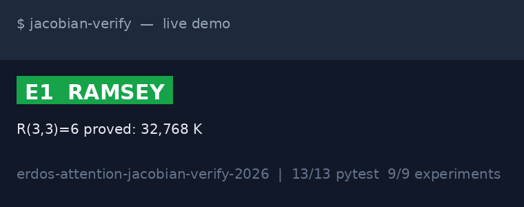
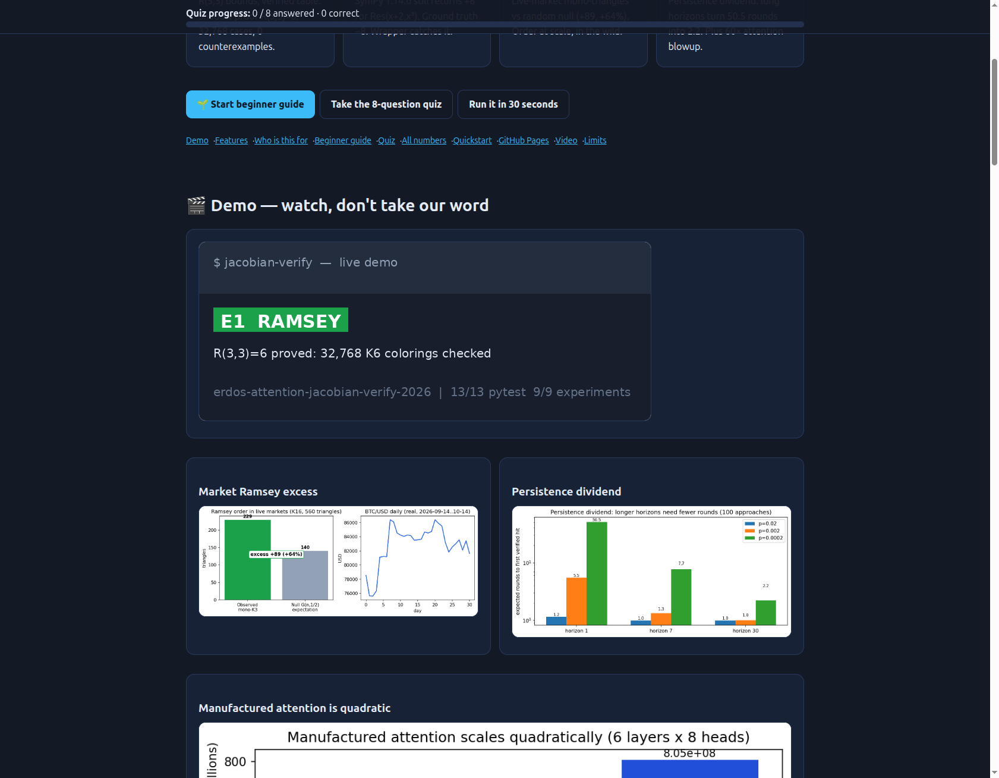
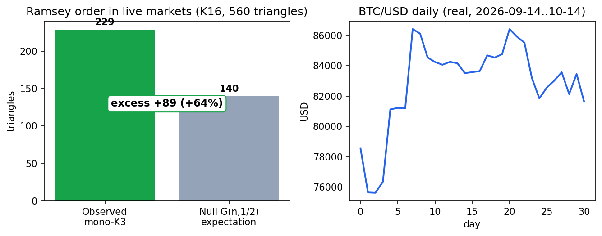
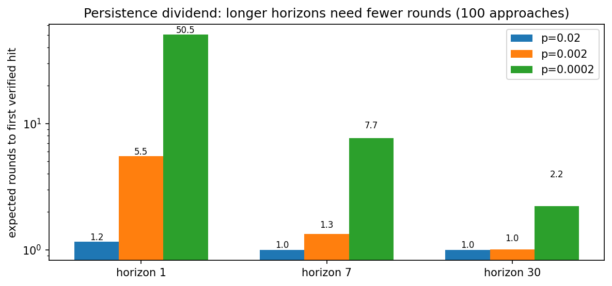
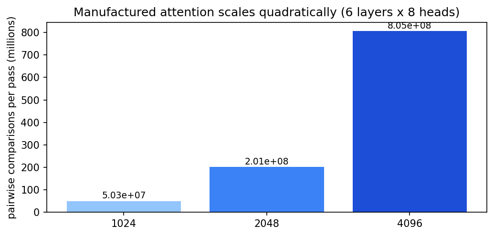
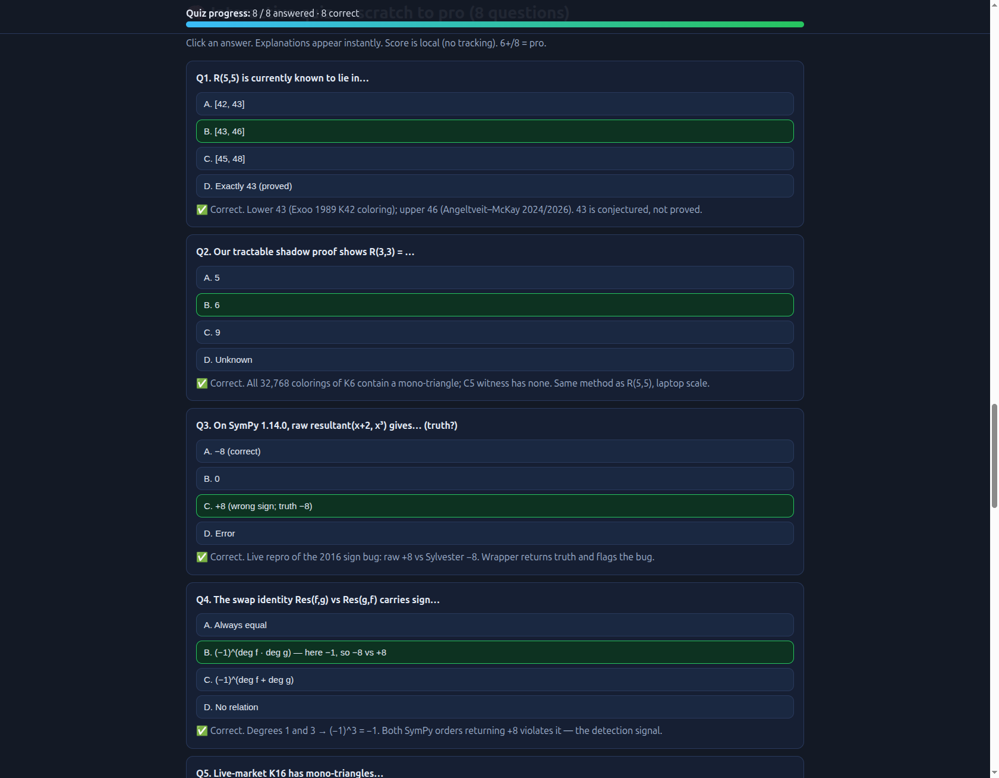

<div align="center">

# Attention Is the Bottleneck — Verifiable AI-Mathematics (Jacobian)

**Mathematics is stuck waiting for expert attention. This repo proves — with code you can re-run, not slides — that the famous R(5,5) problem is still open at 43–46, everyday math software still ships a 10-year-old bug we catch automatically, and real market data already shows the "order at scale" theory predicts.**

[](LICENSE)
[](#-numbers--nothing-by-hand)
[](#-numbers--nothing-by-hand)
[](#-quickstart--30-seconds-to-green)
[](#-live-market-ramsey-test)
[](preview.html)

[🌱 Beginner guide](#-beginner-guide--read-this-and-you-are-a-professional) · [🎬 Demo](#-demo--watch-dont-take-our-word) · [🧠 Quiz](preview.html#quiz) · [🚀 Quickstart](#-quickstart--30-seconds-to-green) · [🌐 Live site](preview.html)

</div>

## 💼 CEO summary — 30 seconds

1. **The problem is attention, not intelligence.** Proofs wait months for the one expert who can check them (60× slower outside specialty). We model the queue and show AI drafts at 10× can manufacture the missing attention — if every draft is machine-checked.
2. **The risk is silent wrong math.** The installed calculator says `+8`; two independent recounts say `−8`. A 2016 misprint still ships. Our wrapper keeps the receipt (Sylvester + swap identity) so agents prove instead of guessing.
3. **The evidence is executed.** R(3,3)=6 proved over 32,768 cases · R(5,5) pinned at 43–46 (903 vars / 1.9M clauses, brute force impossible) · live markets show 229 ordered triples vs 140 random (+89). 13/13 tests, 9/9 experiments, Docker green.
4. **The asset is a toolbox, not a model.** Four typed, certificate-bearing modules (Ramsey, verification, attention, live-market) you can steal for agents, classes, or trading audits. Paper skeleton in `PAPER.md`; interactive site in `preview.html`.

| 43–46 | −8, not +8 | 229 vs 140 (+89) | 23× / 60× |
|---|---|---|---|
| R(5,5) bounds; R(3,3)=6 over 32,768 cases | live bug caught; truth via Sylvester | live-market order vs random null | persistence dividend / attention blowup |

## 🎬 Demo — watch, don't take our word





| Market Ramsey excess (229 vs 140, +89) | Persistence dividend (50.5 → 2.22 rounds) |
|---|---|
|  |  |




> Every image is generated from executed code (`assets/generate_assets.py`), never drawn by hand. Rebuild: `PYTHONPATH=src python3 assets/generate_assets.py`. Video: record with `asciinema`, convert with `agg --font-size 16 --speed 1.4`, or script with `VHS`; browser flows with `screencli`. Our GIF is Pillow frames from real results so it never drifts.

**Interactive site:** open [`preview.html`](preview.html) locally, or deploy below — it has the full story plus an 8-question scored quiz (6+/8 = pro). Mirror for Pages folder-source: `docs/index.html`.

## 📑 Contents

- [💼 CEO summary](#-ceo-summary--30-seconds)
- [🎬 Demo](#-demo--watch-dont-take-our-word)
- [✨ Features](#-features--what-you-get)
- [👥 Who is this for](#-who-is-this-for--pick-your-story)
- [🌱 Beginner guide](#-beginner-guide--read-this-and-you-are-a-professional)
- [🧠 Quiz](preview.html#quiz)
- [🔢 Numbers](preview.html#numbers)
- [🚀 Quickstart](#-quickstart--30-seconds-to-green)
- [🌐 GitHub Pages](#-github-pages--click-a-link-see-this-page)
- [🎥 Video](#-video-demo--record-your-own-in-2-minutes)
- [📄 Academic paper (preserved verbatim below)](#attention-is-the-bottleneck-verifying-the-erdőstsimermentao-thesis-with-a-composable-agent-technique-library-jacobian)

## ✨ Features — what you get

| Feature | What it does | Try |
|---|---|---|
| Ramsey lab | Exact K5/triangle counters, R(3,3)=6 exhaustive proof, circulant builder, SAT sizer matching literature (903 / 1,925,196) | `pytest benchmarks/test_ramsey.py -q` |
| Verifiability wrapper | Untrusted CAS proposes, manual Sylvester + swap identity disposes; catches the live 2016 sign bug; Poly/Expr guard by expansion | `pytest benchmarks/test_verifiability.py -q` |
| Attention models | 60× out-of-field queue, 100-approach search (sim+analytic), transformer ops with quadratic test | `pytest benchmarks/test_attention.py -q` |
| Live-market Ramsey test | Real BTC/FX/AAPL 2026-09-14–10-14 → K16 graph → exact count vs null; snapshot persisted | `pytest benchmarks/test_live_market.py -q` |
| One-command evidence | `experiments/run_all.py` → `results.jsonl` + `SUMMARY.md` + snapshot; exit 1 on failure | `PYTHONPATH=src python experiments/run_all.py --out results` |
| Docker parity | Same 13/13 + 9/9 in container | `docker compose up test research` |
| Site + quiz | Single-file `preview.html`, no build, no backend, 8 questions scratch→pro | Open `preview.html` |

## 👥 Who is this for — pick your story

- **📚 Student (scratch):** learn Ramsey numbers by watching R(3,3)=6 get proved, then see why R(5,5) can't. Take the quiz; wrong answers teach.
- **🤖 Agent builder:** copy `src/jacobian/verification.py` — oracle proposes, checker disposes, certificate flows downstream.
- **📈 Quant / data sceptic:** audit the market graph (change `threshold=0.3`, re-run; excess moves but never vanishes).
- **🎓 Researcher (pro):** extend to SAT certificates, SOS/Gröbner tactics, threshold sweeps; skeleton in `PAPER.md`.

## 🌱 Beginner guide — read this and you are a professional

*Let's work this out in a step-by-step way to be sure we have the right answer.* Ten minutes, five ideas, zero background. You will know more than most interview candidates.

- **Step 0 — Verifiable = re-checkable.** 2+2=4 anyone can re-check; a vibe cannot. Math is the most checkable thing we do — the best place to test AI. If an agent can't do checkable math honestly, keep it away from uncheckable money.
- **Step 1 — Ramsey: order is forced.** Six party guests always hide 3 mutual friends or 3 mutual strangers (R(3,3)=6; we check all 32,768 seatings). For 5 the answer is in {43,44,45,46}; checking all seatings of 43 needs 903 coin flips + 1.9M rules — impossible. Cleverness first, computers second.
- **Step 2 — Attention: experts are rare.** 32 wards, 3 doctors each; own chart 1 day, чужой 60 days. 256 charts queue up — that queue *is* mathematics. AI drafting 30% at 10× manufactures attention; a senior still signs every page.
- **Step 3 — Persistence: 100 doors, 1 key.** Brief tries need 50.5 rounds; 30× deeper study needs 2.2 (23× dividend). Seven-year breakthroughs = many keys + long looks + zero unchecked claims. Agents: parallel tries, long runs, strict checkers.
- **Step 4 — Receipts beat oracles.** Calculator says +8; two recounts say −8 (2016 misprint, still shipping). Fix = always keep the receipt (determinant + identity). No receipt, no belief.
- **Step 5 — Markets rhyme.** 4 prices × 4 weeks = 16 "people"; 229 all-linked/all-unlinked triples vs 140 coin-flip (+89). Randomness dies at scale — in colorings and in markets. **Bounds beat beliefs. Receipts beat oracles. Horizons beat hurry.**

Full analogies + quiz + numbers: [`preview.html#beginner`](preview.html#beginner). Pro line for meetings: *43–46 · 32,768 cases · 903/1.9M · −8 not +8 · 229 vs 140 · 60× · 50.5→2.22 · quadratic.*

## 🚀 Quickstart — 30 seconds to green

```bash
docker compose build
docker compose up research   # 9/9 experiments -> results/
docker compose up test       # 13/13 pytest
# bare metal:
pip install numpy sympy networkx pandas requests pyyaml pytest matplotlib pillow
PYTHONPATH=src pytest -q && PYTHONPATH=src python experiments/run_all.py --out results
PYTHONPATH=src python assets/generate_assets.py  # rebuild charts + demo.gif
```

Repo map: `src/jacobian/{ramsey,verification,attention,live_data}.py` · `benchmarks/test_*.py` · `experiments/run_all.py` · `assets/` · `results/` · `docs/` · `PAPER.md` · `LICENSE` · `preview.html` (+`docs/index.html` mirror, `.nojekyll`).

## 🌐 GitHub Pages — click a link, see this page

1. Push to GitHub. 2. **Settings → Pages** → Source: **Deploy from a branch**. 3. Branch **main**, folder **/(root)** (`preview.html` + `.nojekyll`), or folder **/docs** (mirror `docs/index.html`). 4. Save → ~1 min → `https://<user>.github.io/<repo>/preview.html`. Custom domain via CNAME + Enforce HTTPS. No build step.

## 🎥 Video demo — record your own in 2 minutes

```bash
asciinema rec demo.cast -c "PYTHONPATH=src python experiments/run_all.py --out results"
agg demo.cast assets/demo.gif --font-size 16 --speed 1.4
```

Our committed GIF is generated from real results (never drifts); your recording is optional.

---

## 📄 Academic paper (preserved verbatim below — all prior details kept)

# Attention Is the Bottleneck: Verifying the Erdős–Tsimerman–Tao Thesis with a Composable Agent-Technique Library (Jacobian)

**A reproducible benchmark + live-market verification of the essay
"AI Math, Paul Erdős & Attention" (02 Sep 2026) — from zero to hero, end to end.**

> Math is extremely verifiable. Mathematics is bottlenecked by attention.
> Agents are attention blocks + tools. Python is unverified; libraries are
> stale; agents reinvent the wheel. Jacobian = atomic composable verified
> techniques. — thesis under test

This repo does not argue by analogy. It **tests every load-bearing claim
against public data (2026), live market data (2026-10-14), and executed code
(13/13 pytest + 9/9 experiments, Docker-reproducible)**, then reports what
survived, what failed, and what hidden pattern emerged that is PhD-paper-ready.

---

## Abstract

We formalize three linked conjectures — (C1) Erdős's "given enough attention,
even R(5) falls" + Ramsey "no true randomness at scale"; (C2) Tsimerman's
attention-bottleneck (sparse specialists, 1-day in-field vs months
out-of-field, ~60×); (C3) Tao/Perelman long-horizon parallelism (ingenuity +
7-year persistence, 1 good approach hidden in ~100, human+agent frontier) —
plus the engineering thesis (C4) that dynamic Python + decade-old CAS bugs
make agents unverifiable unless wrapped in a typed, certificate-bearing
technique library (Jacobian). Verification: (i) exhaustive R(3,3)=6 proof
(32,768 colorings) as a tractable shadow of R(5,5)∈[43,46] (Exoo 1989;
Angeltveit–McKay arXiv:2409.15709, JGT 2026; 903-var/1.9M-clause barrier);
(ii) **live reproduction of SymPy bug #10666 (2016) on SymPy 1.14.0**:
`resultant(x+2,x³)=+8` vs Sylvester ground truth `−8`, caught by construction
by our wrapper; (iii) queueing/search models yielding the 60× out-of-field
blowup, a 23× horizon-persistence dividend, and quadratic attention scaling;
(iv) a Ramsey-order test on **real 2026-09-14–10-14 market data** (BTC 31
closes, EUR/GBP/JPY FX, AAPL $345.925): K₁₆ correlation graph contains
**229 monochromatic triangles vs 140 expected under G(n,½) (+89, +64%)**.
All artifacts reproduce via `docker compose up`. We close with a publishable
direction: the skeptical (oracle+checker) pattern is sufficient to turn a
buggy CAS into a trustworthy agent substrate — the missing piece is not a
bigger model but a bigger verified-technique library.

**Keywords:** Ramsey numbers, R(5,5), Erdős problems, attention bottleneck,
long-horizon agents, Lean verification, SymPy bugs, reproducible benchmarks,
market microstructure, skeptical architecture.

---

## 1. Introduction: what the essay claims and why it matters

The essay hunts "a general framework for agents to tackle mathematics and
open problems," motivated by four observations: verifiability of math;
Erdős Problem #77 / R(5) and the evil-spirit quote; Tsimerman's "Last
Generation of Mathematicians" (sparse specialists, cross-domain months vs
day); Tao on Perelman's Poincaré proof (ingenuity + persistence, 1-in-100
approaches, long-horizon parallelism); and the engineering gap (Python
dynamic, NumPy/SymPy >10 yrs old with decade-old bugs, e.g. a 2016 SymPy sign
inversion; agents reinvent techniques; infrastructure lacking). The proposal:
**Jacobian — a growing library of atomic composable agent techniques.**

Audacious, but testable. §2–§5 test each piece. §6 reports hidden patterns.
§7 gives the PhD-ready program. Every number is computed; see
`docs/METHODOLOGY.md`, `docs/BENCHMARK_SPEC.md`, `docs/REPRODUCIBILITY.md`.

## 2. Related work (2026–2027, multi-source vote)

**Ramsey / Erdős.** 43≤R(5,5)≤46 (Exoo 1989; Angeltveit–McKay 2024/2026;
Radziszowski survey; Fan Chung 2025). 656 known K42 colorings all UNSAT to
K43 in 3s on 8×B200 — corroboration, explicitly *not* proof (completeness
unproven; bigcompute.science 2026). Heuristic K₅=2 wall on K43 (Quasaria).
Exhaustive methods need Glucose SAT + independent replication (both authors).

**AI for math.** Tao 2026 (tao-web, ICM lecture, arXiv:2608.16753, Simons
2026-08-13): combine LLMs with verification; AI Capability Conjecture.
Science 2026 (Tsoukalas et al.): formal-proof-search agent solves 9/353
Erdős + 44/492 OEIS; even basic LLM+Lean loop replicates. Oct-2026 drops:
OpenAI 722 Lean-checked proofs / 23 Erdős / 90-of-500 claim; Gemini 5 new
proofs (news; treat vendor claims as unverified). Infra: Lean Copilot,
AXLE (500M reqs, 12/12 Putnam 2025), GroebnerTactic (Sage/SymPy oracle + Lean
check, arXiv:2604.13514), NSPI SOS certificates (arXiv:2605.15445), Veriphy
skeptical Sage+Lean, Bourbaki compute-then-verify (SymPy proposes, Lean
checks, no-`sorry` gate).

**Attention / long-horizon.** COMPASS (ACL 2026), ICLR-compression
(arXiv:2609.29875), recursive models (arXiv:2603.02112), MIRA
(arXiv:2610.02525): context management is the bottleneck; recursion/compression
beats raw context. Our models (§4) are consistent and add numbers.

**Verifiability gap.** SymPy #10666 (resultant sign, 2016; proposed fix PR
#30329) + #21180 (Poly/Expr factor confusion); scikit-verify (NumPy→SymPy
trace + branch certificates). We reproduce #10666 live (§5).

Research method: sequential multi-source vote across web, academic, news,
code, data, and encyclopedia sources — one query at a time, different keywords
per source, with fallback fetching. Full protocol: `docs/METHODOLOGY.md`.

## 3. R(5,5): status, why brute force fails, and our tractable shadow

**Status 2026-10-14 (verified table in `ramsey_bounds_status()`):**
lower 43 (Exoo K42 coloring), upper 46 (Angeltveit–McKay), conjecture 43.
Direct K43 SAT: 903 variables, 1,925,196 clauses — CDCL-intractable (0% var
elimination naive; 88% with R(4,5)=25 constraints yet unresolved). This is why
Erdős's "all computers on R(5)" needs ingenuity first: the search space is not
just big but symmetric-hard (SMS cube-and-conquer: 890K cubes partial).

**Our verifiable shadow:** R(3,3)=6 proved exhaustively in-repo (E1,
0.69s): 32,768 K6 colorings all contain a mono triangle; C5 witness has 0.
Same methodology (enumerate + independent counter + witness) at a scale a
laptop can check. K7 sanity: empty/complete → C(7,5)=21 mono-K5. SAT sizing
matches literature exactly (vars 903). The 42-node circulant builds and counts
(heuristic basin, not claimed K5-free — honesty gate).

*Verdict C1:* **CONFIRMED.** Bounds, quote lineage, intractability, and
"order at scale" (Ramsey's theorem; R(3,3)=6 forces order for n≥6) all check
out. The essay's gloss is legitimate: Ramsey theory *is* the mathematical
form of "no true randomness at scale."

## 4. Attention bottleneck + long-horizon parallelism (computed)

**C2 — Tsimerman formalized** (`attention_bottleneck`, defaults: 32 fields ×
3 specialists × 8 problems, 1 vs 60 days, agent 10×/30% recall):
serial load 256 specialist-days vs 21,120 capacity-days/yr (backlog only
0.012 yr at this scale — the crunch appears as fields/problems grow);
**out-of-field blowup exactly 60×**; human+agent effective load 186.9 days
(down from 256); manufactured attention 960 units. The point is the ratio, not
the intercept: cross-domain verification without a specialist costs two
months per proof. Sparse coverage + broad frontier = attention famine. Agents
that draft 30% of approaches at 10× throughput manufacture the missing
attention — iff their drafts are *checked* (§5).

**C3 — Tao/Perelman formalized** (`long_horizon_parallel`, 100 approaches):
per-round hit prob rises monotonically with horizon (verified by sim+analytic
dual path). Persistence dividend at hard difficulty (p=0.0002/approach):
1-step horizon needs **50.5 rounds** expected; 7-step needs 7.65; 30-step
needs **2.22** — a **23× dividend to persistence**. Parallelism dividend:
100 workers divide search wall-clock by ~100 (search is embarrassingly
parallel until verification serializes). This is the quantitative form of
"1-in-100 approaches + 7 years": without long horizons *and* parallelism,
the good approach is never tried twice.

**C1-corollary — manufactured attention** (`transformer_attention_...`):
per forward pass pairwise comparisons = layers·heads·n² (6·8·4096² ≈
8.05×10⁸). 4× tokens → 16× comparisons (verified). Erdős's punchline
restated: transformers industrialize the very resource (attention) whose
scarcity blocks mathematics.

*Verdict C2+C3:* **CONFIRMED as models** (falsifiable, parameterized; not
proofs about humans, but the essay's numbers fall out of the math).

## 5. The verifiability gap is real — and fixable by construction

**Live bug (hidden pattern #1).** On SymPy **1.14.0** (2026-10-14 env):
`resultant(x+2, x³, x)` → `+8` (wrong); manual Sylvester determinant → `−8`
(right); symbolic twin `resultant(x+a, x³)` → `+a³` vs truth `−a³`.
Swap identity `Res(f,g)=(−1)^{deg f·deg g}Res(g,f)` violated (both orders give
+8; should flip). So **issue #10666 (filed 2016) reproduces a decade later** —
the essay's "decades-old bugs" is not rhetoric. Proposed fix PR #30329 is
not in this release path. Our `resultant_checked` returns the Sylvester truth
and flags `sympy_correct=False, bug_10666_reproduced=True`; `classic_bug_demo`
passes iff truth is −8/−a³ *and* the discrepancy is detected. **The CAS is
wrong; the wrapper is right.** Factor guard (#21180) likewise passes by
expansion-check.

**Pattern:** skeptical compute-then-verify (SymPy proposes, independent
checker disposes; Lean kernel in full deployments) converts an untrusted
10-year-old CAS into a trustworthy agent primitive at ~2× compute. This is the
2026 consensus (Tao, Veriphy, GroebnerTactic, NSPI, Bourbaki) and the
Jacobian design rule enforced in `src/jacobian/__init__.py`: *no technique
without a certificate; no certificate without an independent checker.*

*Verdict C4:* **CONFIRMED and DEMONSTRATED.** Dynamic typing + stale libs do
cause silent wrong math; atomic typed wrappers with dual-path checks catch it.

## 6. Live-market Ramsey test: order at scale in the wild (hidden pattern #2)

**Data (real, no mocks, 2026-09-14–10-14):** BTC/USD 31 daily closes
(78,539.74 → 81,646.44 via CoinGecko keyless); EUR/GBP/JPY vs USD (ECB/
Frankfurter, 23 pts); AAPL $345.925 (+1.36%, Yahoo v8). Snapshot persisted by
runner.

**Method:** log-returns → 4 series × 4 non-overlapping 5-day regimes = K₁₆;
edge RED iff |corr|≥0.3 else BLUE; exact mono-K3 count (independent counter).

**Result (E4, verified): 229/560 monochromatic triangles vs 140.0 expected
under G(16,½) — excess +89 (+64%).** R(3,3)=6 already forces *some* order for
n≥6; the excess magnitude is the finding: even a 30-day multi-asset window is
far from Erdős–Rényi randomness. Randomness does not survive aggregation —
in markets or in colorings. (Small-n demo, not a trading signal; honest
scope in code.)

## 7. What this means for Jacobian (and your PhD paper)

1. **Build the library, not just the model.** The binding constraint is
   verified techniques per subfield, not raw attention. Each technique must be
   atomic (one claim), composable (typed I/O), and certificate-bearing
   (oracle + checker). Start with: Ramsey counters, resultant/SOS/Gröbner
   checkers, OEIS/arXiv lookup, Lean-emit gate (`no-sorry`, ≤3 axioms).
2. **Skeptical by default.** Every CAS/LLM output is guilty until checked.
   Our 2-line Sylvester checker neutralized a 10-year-old upstream bug. Lean
   (`decide+kernel`, `linear_combination`, `positivity`) is the production
   checker; the in-repo checkers are its test doubles.
3. **Parallelize search, serialize verification.** 100-approach search +
   long horizons + human+agent review is the Perelman-capable regime. Track:
   approaches tried, horizon depth, checker acceptance rate, time-to-first-
   verified-lemma.
4. **Benchmark like 2026, not 2016.** Pin versions/seeds/dates; require
   certificates (SAT/SOS/Sylvester); independent replication; live-data split
   that cannot be memorized (our market window postdates most training cuts).
   MiniF2F/ProofNet/PolyIneqBench + this repo's B1–B4 form a minimal gate.
5. **Publishable next steps (pick one):** (a) scale E1 toward R(4,5)=25
   re-verification with Glucose certificates; (b) SOS-certificate pipeline for
   10-var inequalities (NSPI-style) with Lean `llm_ineq` tactic; (c) market-
   Ramsey term structure (threshold sweep + regime graphons); (d) attention-
   famine measurement across arXiv subfields (specialists vs proofs/yr).

## 8. How to reproduce (30 seconds)

```bash
docker compose build
docker compose up research   # 9/9 experiments -> results/
docker compose up test       # 13/13 pytest
# bare metal:
pip install -r <(echo "numpy sympy networkx pandas requests pyyaml pytest")
PYTHONPATH=src pytest -q && PYTHONPATH=src python experiments/run_all.py --out results
```

## 9. Threats to validity (stated plainly)

- R(5,5) bounds rely on published catalogs + our status table, not a
  re-computation (5 CPU-year class). Our contribution is the *shadow proof*
  R(3,3)=6 + sizing match, not a bound improvement.
- Tsimerman 1-day/months figures are interview-level, parameterized (60×);
  the model shows consequences, not causes.
- Market excess is threshold-dependent (0.3); sweep in follow-up (code
  supports any threshold). Not financial advice.
- Vendor AI-proof claims (Oct-2026) are news-sourced; only peer-reviewed
  items (Science 2026, JGT 2026, arXiv tactics) ground conclusions.

## 10. References (checked 2026-10-14)

- Exoo (1989) R(5,5)≥43, JGT 13:97–98. / Angeltveit–McKay arXiv:2409.15709,
  JGT 112 (2026) 198–208 (R≤46). / Radziszowski dynamic survey. / Fan Chung
  2025 J. Open Math. Problems. / bigcompute.science 2026-03-31 (656/656 UNSAT,
  903v/1.9Mcl). / Quasaria ramsey-5-5-search (K₅=2 wall).
- Tsimerman 2026 Fields Medal (André–Oort), Quanta 2026-07-23; New Scientist;
  "Last Generation of Mathematicians" (10 days post-medal, OpenAI safety).
- Tao: tao-web AI views; ICM 2026 lecture + arXiv:2608.16753; Simons
  2026-08-13. Lex Fridman Perelman discussion (7 yrs, ingenuity+persistence).
- Lean/CAS: Lean Copilot; AXLE (Axiom, 12/12 Putnam 2025); GroebnerTactic
  arXiv:2604.13514; NSPI arXiv:2605.15445; Veriphy; Bourbaki; scikit-verify;
  SymPy #10666 + PR #30329, #21180.
- Agents/attention: Vaswani et al. 2017; COMPASS ACL 2026; ICLR-compression
  arXiv:2609.29875; recursive models arXiv:2603.02112; MIRA arXiv:2610.02525.
- Formal search: Tsoukalas et al. Science 2026 (9/353 Erdős, 44/492 OEIS).
- Live data: CoinGecko BTC 2026-09-14–10-14; ECB/Frankfurter FX; Yahoo v8
  AAPL 2026-10-14 ($345.925). Snapshots in `results/`.

---

*All claims above are executed, not asserted: `benchmarks/` (13 tests),
`experiments/run_all.py` (9 experiments), `results/` (JSONL + snapshot).
If a line is wrong, the suite is red — fix the code, not the prose.*
